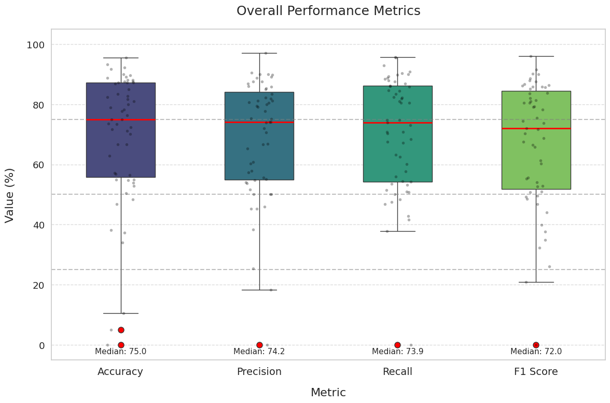
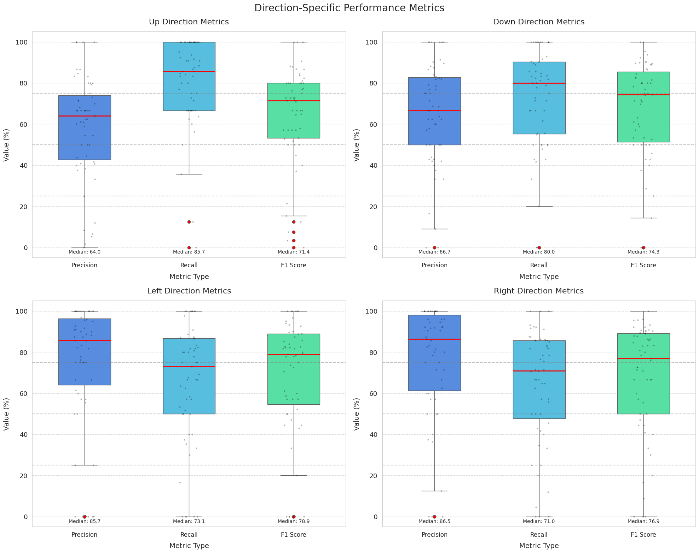
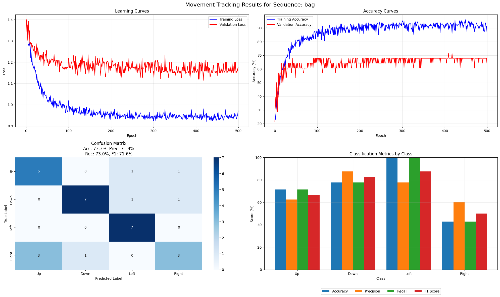

# Motion Direction Detection with Spiking Neural Networks

A biologically inspired vision system that uses a **Spiking Neural Network (SNN)** to detect which way an object is moving (up, down, left or right) in short video clips.

> Group project for *Neural Networks and Learning Machines (D7046E)*, Luleå University of Technology, March 2025. Team "Retina 13".



## Highlights

- **Spiking network built in snnTorch:** leaky integrate-and-fire neurons process frames over time instead of as single images.
- **Motion-focused preprocessing:** frame differencing plus a Haar wavelet transform turns raw video into sparse, spike-friendly input.
- **Evaluated at scale:** trained and tested separately on 55 sequences from the VOT2015 benchmark.
- **Median accuracy of 75%** across sequences on a four-class problem (25% is chance), with the best sequences above 95%.

## Problem

Conventional CNNs look at frames one at a time. Biological vision instead reacts to *change over time*. The goal was to build an SNN that responds to directional movement of a tracked object, using the temporal dynamics of spiking neurons for efficient, event-driven motion detection.

## Data

[VOT2015](https://www.votchallenge.net/vot2015/) from the Visual Object Tracking Challenge: 60 short sequences (about 370 frames on average, 30 fps), fully annotated with rotated bounding boxes. It is hard on purpose, with illumination changes, occlusion, motion blur, scale changes and camera motion.

- **Samples:** each sequence is turned into overlapping 5-frame mini-videos with a sliding window.
- **Labels:** the bounding-box centre (the average of its four vertices) is compared between the first and last frame of each clip, and the larger of the horizontal and vertical displacement sets the direction.
- **Split:** stratified 70% train, 15% validation, 15% test, per sequence.

`python main.py download` fetches the data directly from the VOT servers, so no dataset is stored in this repo.

## Method

```
frames → resize 128×128 → frame difference → Haar DWT (threshold) → spike input
       → [Linear → LIF → BatchNorm → Dropout] × 2 → Linear → LIF → direction (U/D/L/R)
```

| Component | Choice |
|---|---|
| Framework | PyTorch + snnTorch |
| Neurons | Leaky integrate-and-fire (`snn.Leaky`), β = 0.69 |
| Hidden layers | 200 → 100 units, BatchNorm, 30% dropout |
| Time steps | 5 (one per frame in each mini-video) |
| Optimiser | SGD with momentum 0.9, initial LR 0.07 |
| LR schedule | ReduceLROnPlateau (factor 0.75, patience 15, min 1e-6) |
| Training | Up to 500 epochs, early stopping (patience 100), best validation model kept |
| Loss | Cross-entropy |

β, the membrane decay rate, was the hardest hyperparameter to tune: objects moving at different speeds favour different amounts of neuron "memory".

## Results

Averaged over 55 test sequences:

| Metric | Mean ± Std | Median | Max |
|---|---|---|---|
| Accuracy | 69.2 ± 22.2 % | 75.0 % | 95.5 % |
| Precision | 68.5 ± 20.1 % | 74.2 % | 97.1 % |
| Recall | 70.3 ± 19.1 % | 73.9 % | 95.6 % |
| F1 score | 66.8 ± 21.1 % | 72.0 % | 95.9 % |



Example of one sequence ("bag"): learning curves, confusion matrix and per-class scores.



### What drove performance

- **Sequence length:** the shortest clip (41 frames) gave too little training data and scored 0%, while the longest (1,500 frames) reached 88% accuracy and F1.
- **Class imbalance:** some clips contain almost no vertical or horizontal motion. Imbalance was measured per sequence with normalised standard deviation and Shannon entropy, and more balanced sequences scored higher.

## Repository structure

```
├── main.py                          # command-line entry point
├── snn_motion/
│   ├── vot.py                       # VOT2015 download
│   ├── preprocessing.py             # frame differencing, Haar DWT, mini-videos, labels, splits
│   ├── model.py                     # the spiking network (snnTorch)
│   ├── train.py                     # training, early stopping, evaluation, per-sequence figure
│   ├── experiment.py                # one model per sequence -> results CSV
│   └── analysis.py                  # summary table, class balance (NSD, entropy), plots
├── tests/                           # pytest checks on a synthetic moving-square sequence
├── assets/                          # result figures used in this README
├── docs/
│   └── presentation.pdf             # final project presentation
└── requirements.txt
```

## Running it (VS Code / Python)

```bash
python -m venv .venv
source .venv/bin/activate        # Windows: .venv\Scripts\activate
pip install -r requirements.txt

python main.py list                       # the 60 VOT2015 sequence names
python main.py train bag                  # download one sequence, train, evaluate -> outputs/bag_results.png
python main.py run-all                    # all sequences -> results/snn_results_<time>.csv
python main.py run-all --sequences bag ball1 --epochs 100
python main.py analyze results/snn_results_<time>.csv   # summary table + figures in outputs/analysis/
```

Sequences download to `data/sequences/`, best models to `models/`. Hyperparameters (`--beta`, `--lr`, `--epochs`, `--patience`, `--batch-size`) default to the values in the table above. In VS Code, open the folder, select the `.venv` interpreter and use the **Run and Debug** panel (`.vscode/launch.json`). `pytest` runs quick checks on a synthetic sequence. Training on all 60 sequences takes a while on CPU, so a GPU is recommended.

## Limitations and future work

- **Training SNNs is still hard.** Spikes are non-differentiable, so training relies on surrogate gradients, and deeper SNNs suffer from vanishing or exploding gradients.
- **Neuromorphic hardware:** running the model on chips such as Intel Loihi would show the real energy and latency benefits.
- **Event cameras:** real neuromorphic sensor data would be a more natural input than differenced RGB frames.

## Team

Antonino Davolos, Sandra Sandström, Felix Hessinger, **Aamer Barood**, Hind Dafallah, Christos Michail.
